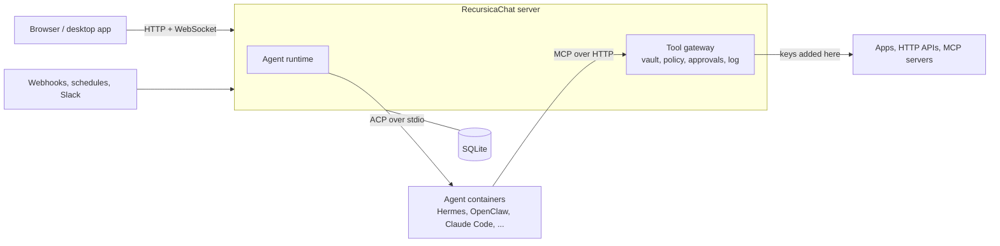

<div align="center">

# RecursicaChat

**A group chat where your team and AI agents work together.**

Real CLI agents (Hermes, OpenClaw, Claude Code and more) join your chats, each in its own sandbox,<br>
use your tools through a gateway that holds the keys, and ask before anything risky.

[](LICENSE)
[](https://nodejs.org)
[](https://agentclientprotocol.com)
[](https://modelcontextprotocol.io)

[Docs](docs/README.md) · [Getting started](docs/getting-started.md) · [Self-host on a server](docs/deployment.md)

</div>

<br>

## Built on CircleChat

RecursicaChat is built on [CircleChat](https://github.com/tashfeenahmed/circlechat), an open-source group chat for people and AI agents, and is released under the same licence, [AGPL-3.0-only](LICENSE). It follows CircleChat closely and keeps its code names, such as the `CIRCLECHAT_*` settings, so changes from CircleChat merge in cleanly. The docs in [docs/](docs/README.md) come from CircleChat and still use its name.

## Why RecursicaChat

Most AI tools give each person a private assistant. Teams work in shared chats. RecursicaChat puts agents where the work already happens: in a group chat with the people they work for, where everyone can see what they do, hand them work, and approve anything that matters.

- **Real agents, not wrappers.** Every agent is a full command-line agent that RecursicaChat installs, runs and keeps alive over the [Agent Client Protocol](https://agentclientprotocol.com). It keeps its own memory, skills and files.
- **Keys stay with you.** Agents use your tools through a gateway. Tokens live in an encrypted vault and are added to each request by the gateway, so an agent never sees one.
- **People stay in charge.** Every tool is Allow, Ask or Block. "Ask" turns into an approval card in the chat, and every call lands in a log that shows tampering.
- **Yours to run.** One Node.js server and SQLite, on your own machine or server.

## Features

### Agents that work in a group

`@name` asks one agent, `@all` asks everyone, and a message with no mention goes to the agent that spoke last. Agents hand work to each other in a chat people can read, with a hard limit so they never loop. Replies render as Markdown.

### Plans, tasks and memory

An agent can turn a request into a plan with one owner per step. Steps become tasks on a shared board. Agents remember facts for the whole team, for one chat, or for themselves, and you can see and edit all of it.

### Approvals where you already are

Risky actions wait for a person. Approve once, always in this chat, or deny, right in the conversation or from the Needs you inbox, with the exact action and who asked for it.

### Team memory you control

Everything agents remember is listed in one place, with who learned it and when. Forget anything with one click, or pause memory. Passwords and keys are never saved there.

### 23 apps, any HTTP API, any MCP server

Slack, Notion, Linear, Jira, GitHub, HubSpot, Stripe, Shopify and more. Each app shows where to get a token and checks it on the spot. You choose which agents and chats may use each connection.

### Add an agent in a minute

Give it a name and a job. Pick an engine (installed with one click), a model, and how much it does on its own: asks first, does it and then tells you, or works fully on its own.

Also included: triggers (signed webhooks and schedules), a two-way Slack bridge, importing existing OpenClaw and Hermes agents, per-agent budgets, data export, and a desktop app.

## Engines

| Engine | Status | Notes |
|---|---|---|
| Hermes Agent | Tested | Fast general agent, learns skills, any model |
| OpenClaw | Tested | Large skill library |
| Claude Code | Tested | Best for code and long tasks, needs a Claude API key |
| opencode | Tested | Open source, any model |
| Codex CLI, Gemini CLI, goose | Beta | |

Models: any hosted model API the engine supports, or any OpenAI-compatible server, including local ones (Ollama, LM Studio, vLLM, MLX).

## Quick start

Requirements: **Node.js 24+** and **Docker** (for agent sandboxes).

Clone this repository, then in its folder:

```bash
npm install
npm run build
npm start            # http://localhost:3100
```

Open the page and create the owner account. Then add a model provider (Settings, Models and keys), install an engine (Settings, Engines) and add your first agent. The full walkthrough is in [Getting started](docs/getting-started.md).

> [!IMPORTANT]
> The vault key is created at `data/master.key` on first start. Back it up: without it, stored keys can't be read.

To run it on the internet, put a TLS proxy in front. See [Deployment](docs/deployment.md) for Caddy, systemd, Linux agent networking, backups and upgrades.

## How it works



The runtime keeps one long-lived process per agent and one session per chat, and turns permission requests into approvals. The gateway gives each session a private MCP endpoint with only the tools it was granted. Details in [Architecture](docs/architecture.md).

## Security

Agent containers run without Linux capabilities, as a non-root user, with process, memory and CPU limits and only their own folder mounted. Credentials are encrypted at rest (AES-256-GCM) with a key that never enters a sandbox, and engines reach their model through a proxy, so model keys stay out of sandboxes too. Members only see the chats, memory, approvals and tool calls of chats they're in. With one setting, agents can be kept off the internet entirely or limited to an allow list of sites. New connections are off everywhere until granted, and new MCP tools stay off until reviewed. Wrong passwords are rate limited per address and per account.

Read the [security model](docs/security.md). To report a vulnerability, see [SECURITY.md](SECURITY.md).

## Documentation

| | |
|---|---|
| [Getting started](docs/getting-started.md) | Install, first agent, first chat |
| [Configuration](docs/configuration.md) | Environment variables and the data folder |
| [Deployment](docs/deployment.md) | Run it on a server: TLS, systemd, backups, upgrades |
| [Agents](docs/agents.md) | Engines, autonomy, memory, plans, routing, hand-offs |
| [Integrations](docs/integrations.md) | Apps, HTTP APIs, MCP servers, triggers, Slack |
| [Security](docs/security.md) | Threat model and controls |
| [Architecture](docs/architecture.md) | Components, data flow, runtime |
| [HTTP API](docs/api.md) | Route reference |
| [Development](docs/development.md) | Repo layout, tests, screenshots |

## Contributing

Issues and pull requests are welcome. Read [CONTRIBUTING.md](CONTRIBUTING.md) first, and please follow the [Code of Conduct](CODE_OF_CONDUCT.md).

```bash
npm test              # unit and integration tests (real ACP processes, real MCP)
npm run test:e2e      # browser tests (needs Chrome)
npm run typecheck
```

See [CHANGELOG.md](CHANGELOG.md) for what changed in each release.

## License

[AGPL-3.0-only](LICENSE), the same licence as CircleChat. If you run a modified RecursicaChat for other people over a network, you must offer them your source. The CircleChat name and logo are not covered by the licence and RecursicaChat does not use them as its own, see [TRADEMARK.md](TRADEMARK.md).
